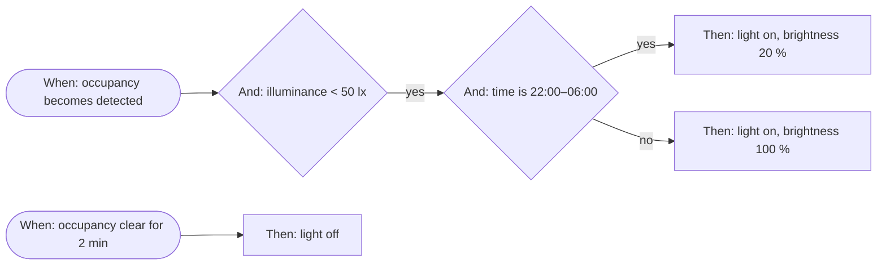

# Automations — Analysis and Design

**Status:** Accepted (nothing implemented). Spike results and the settled decisions are in
[ADR 0003](../../adr/0003-automations-spike-and-decisions.md), which takes precedence where this document is less precise.

**Date:** 2026-11-10

**Author:** Adam Kadlec (drafted with Claude)

**Related task:** `tasks/epics/EPIC-AUTOMATIONS.md` (GitHub epic https://github.com/FastyBird/smart-panel/issues/1555)

## Goal

Let the administrator define automations the way Homey Advanced Flow does: place blocks on a canvas, wire
them, and have the backend run the result. An automation reacts to something (a sensor changed, a time was
reached, a button was pressed), checks conditions, and performs actions, with branches and delays.

The reference scenario, which the finished feature must express on one canvas:

> When the occupancy sensor detects a person and the light level is low, turn on the light. If it is night,
> turn it on at low brightness. Once the occupancy sensor no longer detects a person, turn the light off.



The same model must cover the usual heating, cover, alarm and notification scenarios.

## Summary of recommendations

| Question | Recommendation |
| --- | --- |
| Where does it live? | A new core module `automations` in backend and admin. Not an extension of scenes or spaces. |
| What is extended? | Devices (one event gap), intents (a new origin), spaces-home-control, scenes, security, notifications, tools/MCP/buddy — each contributes node types or a small hook. See [What existing code changes](#what-existing-code-changes). |
| How is an automation stored? | One row per automation with the whole graph (nodes, edges, positions) as a versioned JSON document. YAML is used for hand-written files: templates and import/export. |
| How is it executed? | A small custom engine in the backend: event-driven triggers, token-based graph walk. No rule-engine dependency, no Node-RED. |
| Canvas library? | **Vue Flow** (`@vue-flow/core`, MIT) wrapped in one component of ours. Not custom, not Rete/Baklava/Drawflow/LiteGraph. |
| Panel app? | No editor on the panel. Later: list and enable/disable per space. |
| New dependencies | Admin: `@vue-flow/core` (+ `@vue-flow/background`, `@vue-flow/controls`, optionally `@vue-flow/minimap`). Backend: none required. |

## What exists today

Checked in the code on `main` at `7cfd898`.

**No automation engine exists.** Earlier tasks ruled it out explicitly:

- `tasks/archive/EPIC-SCENES-PLUGIN-MVP.md:18` — "Scenes are NOT automations. No conditional logic, triggers,
  schedules, or workflows."
- `tasks/epics/EPIC-EXPAND-SMART-PANEL-DOMAINS.md:72` — "Complex automation rules engine (use scenes for custom
  sequences)" is out of scope.
- `tasks/features/FEATURE-SPACE-TIME-SCHEDULING.md:72` — "Complex conditions (if temperature > X, then...)" is
  out of scope.
- `docs/hardware-inputs.md:35` — button occurrences are events only, "reserving actuator state changes and
  action routing for future automation capabilities."

**Fixed-purpose automation already ships** and stays as it is:

| Piece | Where | What it does |
| --- | --- | --- |
| Scenes | `modules/scenes`, `plugins/scenes-local` | Ordered list of device property writes, run on demand. |
| Activity modes | `plugins/spaces-home-control` (`SpaceModeService.activateMode`) | Work/Relax/Sleep/Entertainment/Away per space. |
| Mode schedule | `SpaceModeSchedulerService` | Weekly time → mode per space, minute cron, no sunrise/sunset. |
| Occupancy | `space-occupancy*.service.ts` | Occupied/Vacant/Unknown per space from chosen sensors, with vacancy delay; maps to modes. |
| House mode actions | `modules/system/services/house-mode-actions.service.ts` | Hard-coded: Away turns lights off, Night applies night lighting. |
| Virtual devices | `plugins/devices-virtual` | Aggregates, transforms, thermostat control loop. Derived values, not rules. |
| Buddy suggestions | `modules/buddy` | Detects repeated actions and suggests creating a *scene*. |

**Building blocks the engine can reuse directly:**

| Need | Existing piece |
| --- | --- |
| React to a value change | EventEmitter2 event `DevicesModule.ChannelProperty.ValueSet` (payload: the `ChannelPropertyEntity` with `.value`), plus `…ValueStateChanged` for virtual outputs. |
| React to a button press | `DevicesModule.ChannelInput.Occurrence`. |
| React to other state | `SpacesModule.Occupancy.Changed`, `SpacesModule.ActivityMode.StateChanged`, `SystemModule.HouseMode.Changed`, `security:status`, `ScenesModule.Scene.Triggered`, `DevicesModule.Device.ConnectionChanged`, `WeatherModule.Weather.Info`. |
| Read a current value | `PropertyValueService.readLatest(property)` (in-memory cache over storage). |
| Write a device property | `PropertyCommandService.executePropertyCommands(...)` — validates writability and value, creates an intent, dispatches. |
| Run a scene | `SceneExecutorService.triggerScene(sceneId, triggeredBy)`. |
| Tell the user | `NotificationsService.notify(...)`, forwarded to Discord/Slack/Telegram/webhook by plugins. |
| Timers | `@nestjs/schedule` + `SchedulerRegistry`; the minute-cron pattern and DST helpers in `plugins/spaces-home-control/schedule/schedule-time.ts`. |
| Long-running service | `BaseManagedExtensionService` (start/stop/health, shown in admin). |
| Plugin-contributed types | Type-mapper + registry pattern (`SceneActionsTypeMapperService`, `SceneExecutorService.registerPlatform`). |
| Admin plugin forms | `PluginsManager` elements with `components` + `schemas`, resolved by a composable such as `useScenesActionPlugins`. |
| Live admin updates | The websocket gateway forwards every bus event (`eventEmitter.onAny`); modules filter by event prefix. |
| AI / MCP access | `ToolProviderRegistryService.register(provider)`. |

**Gaps found:**

1. The value-set event carries no previous value, so "changed from off to on" cannot be read from the event.
2. There is no local sunrise/sunset calculation; the only source is the weather provider's forecast fields.
3. The admin has no canvas or graph library. `gridstack` (dashboard grid) is the only drag-and-drop dependency
   and does not draw connections.
4. The admin has no standalone device → channel → property picker. That logic is written inline twice
   (`plugins/scenes-local/components/local-scene-action-add-form.vue` and
   `plugins/data-sources-device-channel/components/device-channel-data-source-add-form.vue`).
5. `IntentOrigin` has no value for commands issued by the system itself.

## Prior art

| System | Model | What transfers | What does not |
| --- | --- | --- | --- |
| Homey Advanced Flow | Canvas of cards: **When** (trigger), **And** (condition with yes/no outputs), **Then** (action with done/error outputs), plus Start, Delay, Any, All. Several When cards may share one canvas. | The whole visual vocabulary. Three card kinds users already understand, explicit yes/no branches, Any/All joins, Delay as a block, several triggers on one canvas. | Tags (passing values between cards) and HomeyScript are a later step. |
| Home Assistant automations | List form: triggers, conditions, actions; `mode: single / restart / queued / parallel`; `for:` duration on state triggers; numeric triggers fire on *crossing* a threshold; run traces. | Run modes, "for" durations, crossing semantics, and traces — these are what make motion-light automations behave correctly. | YAML and Jinja templates; a list form cannot show branches clearly. |
| Node-RED | Generic dataflow editor with its own runtime, storage, auth and node catalogue. | Nothing to embed. | A second runtime and UI on a Raspberry Pi, its own user model, no knowledge of our devices, spaces or intents, and an editor that is not Vue. |
| Generic rule engines (`json-rules-engine`, `xstate`) | Evaluate condition trees or state charts. | Nothing we need: the condition logic here is a handful of comparisons. | They do not model triggers, delays or branching graphs, so the engine would still be ours. |

## Product decisions

1. **A new core module, `automations`.** Scenes stay "a list of writes run on demand"; putting triggers into
   scenes would contradict their documented contract and their panel UI. Spaces is the wrong owner because
   automations may span spaces or belong to none. Automations *use* scenes and space modes as actions.
2. **The Homey card model: When / And / Then plus flow blocks.** One automation is one canvas with one or more
   triggers. This is what the user asked for and it expresses the reference scenario without a second
   automation.
3. **The simple per-space features stay.** Mode schedules and occupancy keep their own configuration screens.
   Automations do not replace them; they consume their *results* as triggers and conditions ("when the room
   becomes vacant", "if the room mode is Sleep"). This also means the reference scenario can use the space's
   qualified occupancy state instead of a raw sensor.
4. **No expression language in the first version.** Conditions use fixed operators on typed values. Free-form
   expressions need a sandbox, an editor and error handling, and none of the target scenarios require them.
5. **Node types are a registry, so plugins can add cards.** `spaces-home-control` contributes mode and
   occupancy cards; a future plugin can contribute its own without touching the engine.
6. **The backend is the only executor.** The admin draws and saves; the panel never evaluates rules.
7. **Automations act through the same command paths as a user.** Property writes go through
   `PropertyCommandService`, so validation, intents, optimistic UI and command windows behave identically.

## Concepts

### Automation

| Field | Notes |
| --- | --- |
| `id`, `name`, `description`, `icon` | As for scenes. |
| `enabled` | Disabled automations hold no subscriptions and no timers. |
| `space_id` (nullable) | Optional owning space, for filtering and for a later panel list. Not a restriction on what it may control. |
| `mode` | `single` (ignore new triggers while running), `restart` (cancel the running run, default), `parallel` (bounded). |
| `graph` | `{ version, nodes[], edges[] }`, see below. |
| `revision` | Incremented on each save; the save request carries the revision it was based on (compare-and-swap, same idea as `SpaceModeScheduleEntity.revision`). |
| `status` | `ok`, `invalid` (a referenced device/scene/space was removed or a node fails validation), `suspended` (auto-disabled by the loop guard). |
| `last_triggered_at`, `last_run_status` | For the list view. |

### Graph

```jsonc
{
  "version": 1,
  "nodes": [
    { "id": "n1", "type": "device.property.changed", "position": { "x": 40, "y": 80 },
      "config": { "property_id": "…", "to": true } },
    { "id": "n2", "type": "device.property.compare", "position": { "x": 320, "y": 80 },
      "config": { "property_id": "…", "operator": "lt", "value": 50 } }
  ],
  "edges": [
    { "id": "e1", "source": "n1", "source_port": "out", "target": "n2", "target_port": "in" }
  ]
}
```

Storing the graph as one JSON document, not as node and edge tables, is deliberate. The canvas saves the whole
graph at once, a partial save has no meaning, and the positions are view data that would otherwise need their
own columns. `config` is validated per node type against that type's DTO class, the same way
`SceneActionsService` validates against `mapping.createDto`.

### JSON and YAML

The project uses YAML for files a person writes by hand (the main config file, device mapping definitions,
simulator scenarios, spec definitions) and JSON for records stored in the database and sent over the API
(`SceneActionEntity.configuration`, `SpaceOccupancyEntity.sensorPropertyIds`, the OpenAPI contract).
Automations follow the same split:

| Use | Format | Why |
| --- | --- | --- |
| Stored graph and REST API | JSON | Written by the canvas, not by hand; contains positions and generated ids; described by the OpenAPI schema and the generated admin and panel clients. |
| Templates shipped with the backend | YAML | Hand-authored files in a `definitions` folder with a loader service, like the device mappings. |
| Import and export | YAML | The same graph serialised for sharing and backup. The `yaml` package is already a dependency of backend and admin. |
| "View as YAML" tab in the editor | YAML | Optional, for advanced users; a later addition. |

### Node kinds and ports

| Kind | Inputs | Outputs | Behaviour |
| --- | --- | --- | --- |
| Trigger (When) | none | `out` | Starts a run when its event occurs. |
| Condition (And) | `in` | `yes`, `no` | Evaluates current state and continues on one output. |
| Action (Then) | `in` | `done`, `error` | Performs a side effect, then continues. |
| Flow | varies | varies | Delay, Wait until, Any, All. |

Rules enforced on save: at least one trigger; no edge into a trigger; ports must exist on the node type; every
non-trigger node must be reachable from a trigger (unreachable nodes are a warning, not an error, so a
half-drawn canvas can be saved while disabled); no cycles in the first version.

### First node catalogue

| Kind | Type | Provided by | Notes |
| --- | --- | --- | --- |
| Trigger | Device value changes (to / from / any; above / below a threshold; optional "for" duration) | automations | Covers sensors, switches, thermostats, contact, smoke, leak. |
| Trigger | Button pressed | automations | From `ChannelInput.Occurrence` (press, long press, double press). |
| Trigger | Time of day (time, weekdays) | automations | Minute resolution, house timezone. |
| Trigger | Sunrise / sunset with offset | automations | Phase 2. |
| Trigger | Device goes offline / online | automations | |
| Trigger | Scene was run | automations | |
| Trigger | House mode changed | automations | |
| Trigger | Security state changed (armed, alarm, alert raised) | automations | |
| Trigger | Space occupancy changed | spaces-home-control | |
| Trigger | Space activity mode changed | spaces-home-control | |
| Trigger | Manual start | automations | Lets the admin, a scene tile later, Buddy or MCP run it. |
| Condition | Device value comparison (`eq`, `neq`, `gt`, `gte`, `lt`, `lte`, `between`, `in`) | automations | Operators offered depend on the property's `dataType` and `format`. |
| Condition | Time window, weekdays | automations | Windows may cross midnight. |
| Condition | Day or night (sun position) | automations | Phase 2. |
| Condition | House mode is, security armed state is | automations | |
| Condition | Space is occupied, space mode is | spaces-home-control | |
| Action | Set device value | automations | Same picker and value editor as scene actions. |
| Action | Run scene | automations | |
| Action | Send notification | automations | Severity, title, message. |
| Action | Set house mode | automations | |
| Action | Enable / disable / run another automation | automations | |
| Action | Set space activity mode, space lighting intent | spaces-home-control | |
| Flow | Delay | automations | Up to 1 h in the first version (see [Runs](#runs)). |
| Flow | Wait until (a trigger-style event, with timeout output) | automations | Phase 2. |
| Flow | Any / All | automations | Join branches. |

### Trigger semantics

These rules decide whether automations feel reliable, so they are fixed up front.

- **Triggers fire on transitions, not on every report.** A sensor that reports `detected = true` every 30 s
  fires once. Because the value-set event has no previous value, the engine keeps the last seen value for every
  property that an enabled automation references, and compares against it.
- **Numeric triggers fire on crossing.** "Above 25" fires when the value moves from ≤ 25 to > 25, not while it
  stays above.
- **"For" durations** start a timer on the transition and cancel it if the value leaves the target state.
  The timer is also cancelled when the device goes offline or the value becomes invalid; it starts again only
  after a fresh valid report in the target state. A sensor that reported "clear" and then dropped off the
  network must not turn the light off on its last known value.
- **Startup does not fire.** On boot the engine seeds the last-seen values from `PropertyValueService` without
  firing. "For" timers whose state already holds restart from boot time.
- **Unknown is not true.** A condition on a property with no value, an invalid value or an offline device
  evaluates to `no` and the trace records why.
- **Missed times are not replayed** after a restart, matching `SpaceModeSchedulerService`.
- **An unset clock is not a time.** Until the system clock is set (a board without a real-time clock, before
  the first time sync) time-of-day triggers do not fire and a time-window condition evaluates to `no`. The
  times a clock jump skips are not replayed (ADR 0003, decision 17).

### Runs

A trigger firing creates a run. The run walks the graph as a set of tokens: a token sits on a node, the node
executes, and the token moves along the edges of the output that was taken. Several edges from one output run
in parallel. A Delay parks its token on a timer. The run ends when no tokens remain.

- **Mode** decides what a new trigger does while a run is active (`single`, `restart`, `parallel` capped at
  10). `restart` is the default and cancels **every** active run of the automation, whichever trigger started
  it, including parked delays and waits. It is the only mode in which "becomes clear → Delay → off" lets new
  motion cancel the pending off. "For" durations belong to the trigger, not to a run, so no mode affects them.
- **One automation, one concern.** Under `restart`, unrelated flows on the same canvas cancel each other; the
  editor warns about disconnected sub-graphs.
- **Prefer "for" to Delay for waits on a state.** "Occupancy clear for 2 min → off" is correct in every mode
  and when the sensor drops offline. A Delay before a state-changing action needs a re-check condition after
  it. Templates follow this.
- **Branches are unordered.** Several edges from one output run in parallel with no ordering guarantee; a
  sequence is a chain through `done`.
- **Errors.** An `error` output with no edge ends that token and marks the run `failed`. Every action has a
  timeout. `last_run_status` is `completed`, `failed`, `cancelled` or `interrupted`.
- **Edits.** Saving a changed graph, mode or `enabled` cancels active runs; a save that changes only name,
  description or icon does not.
- **Joins.** Any passes the first arrival and absorbs later ones. All is a strict AND over its incoming edges
  and cannot combine two triggers; "A and B within 30 s" uses Wait until.
- **Run state is in memory.** A restart of the backend ends active runs; they do not resume, which is why Delay
  and Wait until are limited to 1 h in the first version and long waits use a "for" trigger. Durable delays
  are a follow-up; they matter for long delays, which the cap keeps rare.
- **Trace.** Each run records the trigger, the nodes visited, the output taken, the value a condition saw, and
  the result of each action. The last runs per automation are kept (proposed: 50) in a table. The full trace
  is written once when the run ends, to limit SD-card writes.
- **Interrupted runs stay visible.** A run that parks on a Delay or Wait writes a marker row (`running`) at
  that moment, so short runs still cost one write. On startup every row still marked `running` is set to
  `interrupted`, which tells the user why a delayed action never happened, including after a power loss.

### Loop and overload guards

An action can change a value that triggers the same or another automation. The value event does not say who
caused the change, so call-depth tracking is not reliable. The guards are therefore rate based:

- Per automation: more than 30 runs per minute, or more than 200 per hour, sets `status = suspended`, stops it,
  and raises a notification with a link to the automation. The hourly window catches slow loops that pass the
  first. Saving or re-enabling the automation clears the suspension.
- Ignored and dropped triggers are counted per automation and shown, so "why did it not run" has an answer.
- Global caps: automations (proposed 200), nodes per automation (100), concurrent runs (50), delay length
  (1 h).
- The editor warns when an automation writes a property that one of its own triggers watches.

## Backend architecture

```
modules/automations/
  automations.module.ts            registration, same calls as ScenesModule.onModuleInit
  automations.constants.ts         module name, prefix, EventType, limits
  entities/                        AutomationEntity, AutomationRunEntity
  dto/, models/                    create/update DTOs, response models, graph models, node-type catalogue model
  controllers/                     automations, runs, node-types
  services/
    automations.service.ts         CRUD, revision check, graph validation
    node-type-registry.service.ts  register / lookup node types
    automation-engine.service.ts   BaseManagedExtensionService: load, subscribe, dispatch triggers
    automation-run.service.ts      token walk, modes, delays, trace
    state-tracker.service.ts       last-seen values, transition and crossing detection, "for" timers
    time-source.service.ts         minute tick, time and sun triggers
    automation-tool.service.ts     Buddy / MCP tools
  nodes/                           built-in trigger, condition, action and flow handlers
  listeners/                       websocket command handler, cleanup on device/scene/space deletion
```

### Node type contract

```ts
interface AutomationNodeType<TConfig> {
  type: string;                       // 'device.property.changed'
  kind: 'trigger' | 'condition' | 'action' | 'flow';
  ports: { inputs: string[]; outputs: string[] };
  configDto: new () => TConfig;       // class-validator DTO
  references?(config: TConfig): NodeReference[];   // device/property/scene/space ids, for invalidation
}
interface AutomationTrigger<TConfig> extends AutomationNodeType<TConfig> {
  subscribe(config: TConfig, fire: (data: TriggerData) => void): () => void;
}
interface AutomationCondition<TConfig> extends AutomationNodeType<TConfig> {
  evaluate(config: TConfig, ctx: RunContext): Promise<{ result: boolean; observed?: unknown; reason?: string }>;
}
interface AutomationAction<TConfig> extends AutomationNodeType<TConfig> {
  execute(config: TConfig, ctx: RunContext): Promise<{ success: boolean; reason?: string }>;
}
```

`AutomationNodeTypeRegistryService.register(nodeType)` is called from `onModuleInit` of the owning module or
plugin, exactly like `sceneExecutor.registerPlatform(...)`. The registry also feeds
`GET /node-types`, which the admin uses to build the palette, so a backend plugin without an admin counterpart
still shows up with a generic form.

### Engine behaviour

- On start and on every automation create/update/delete/enable, the engine rebuilds the subscriptions for that
  automation only.
- Device triggers do not each add an EventEmitter listener (the bus is capped at 32 listeners per event). The
  state tracker holds **one** listener each for `CHANNEL_PROPERTY_VALUE_SET`,
  `CHANNEL_PROPERTY_UPDATED` and `CHANNEL_PROPERTY_VALUE_STATE_CHANGED` and routes by property id through an
  index. `CHANNEL_PROPERTY_UPDATED` is required: when one update changes both metadata and value,
  `ChannelsPropertiesService` emits only that event, so a tracker without it would miss the transition and
  keep a stale value. The existing space listeners subscribe to both for the same reason.
- Time triggers share one minute tick.
- Property writes are grouped per device before calling `executePropertyCommands`, because that method rejects
  a batch spanning several devices.
- When a referenced device, property, scene or space is deleted, the automation is marked `invalid` and stops;
  the list and the canvas show which node is broken.

### REST API

Prefix `/api/v1/modules/automations`. All routes require `owner` or `admin`.

| Method | Path | Purpose |
| --- | --- | --- |
| `GET` | `/automations` | List (without graphs). |
| `POST` | `/automations` | Create. |
| `GET` | `/automations/:id` | Detail with graph. |
| `PATCH` | `/automations/:id` | Update metadata, graph (with `revision`), `enabled`. |
| `DELETE` | `/automations/:id` | Delete. |
| `POST` | `/automations/:id/trigger` | Manual run; optional start node. |
| `POST` | `/automations/validate` | Validate a graph without saving; returns per-node errors. |
| `GET` | `/automations/:id/runs`, `/runs/:runId` | Run history and trace. |
| `GET` | `/node-types` | Catalogue: type, kind, ports, config JSON schema. |

Events on the bus (and therefore the websocket): `AutomationsModule.Automation.Created|Updated|Deleted`,
`AutomationsModule.Run.Started|Completed`. Per-node step events are sent only to clients that opened the live
view of that automation, to keep the exchange quiet.

Schema names follow the convention: `AutomationsModuleResAutomations`, `AutomationsModuleCreateAutomation`,
`AutomationsModuleDataGraph`, and so on.

### Storage

SQLite, one incremental migration (next free number after `1000000000055`):

- `automations_module_automations` — columns as in [Automation](#automation); `graph` as `simple-json`.
- `automations_module_runs` — `automation_id`, `started_at`, `finished_at`, `status`, `trigger_node_id`,
  `trace` (`simple-json`); pruned to the last N per automation.

### Sunrise and sunset

The weather module only has what the provider returns, which is missing when the provider is not configured
or offline. Lighting automations must not depend on an internet service, so the times should be computed
locally from the configured location. The solar position formula is about 60 lines; `suncalc` is the usual
package for it. Recommendation: implement the calculation in the module and avoid the dependency; confirm
during the phase 2 spike.

## What existing code changes

| Area | Change | Size |
| --- | --- | --- |
| `modules/devices` | None required. Optional: add the previous value to the value-set emission so other consumers can use it too. | small |
| `modules/intents` | Add `'automation'` to `IntentOrigin`, and carry the automation id in `context.extra`, so the panel and Buddy can tell automated changes from user actions. | tiny |
| `modules/buddy` | `ActionObserverService` must ignore intents with the `automation` origin, otherwise automated actions are learned as user habits and suggested back. | small |
| `plugins/spaces-home-control` | Register mode and occupancy node types. Decide how an automation-activated mode ranks against manual, schedule and occupancy activation (see [Decisions to confirm](#decisions-to-confirm-during-review)). Move `schedule/schedule-time.ts` to a shared location so both schedulers use it. | medium |
| `modules/scenes` | None for execution. The engine calls `triggerScene(id, 'automation', { origin: 'automation', extra: { automationId } })`: the second argument is only the `triggeredBy` label, and the intent context comes from the third, so the origin must be passed there for the Buddy filter to see scene runs. A read-only helper that lists a scene's enabled actions is needed for the safety check below. | small |
| `modules/security` | Expose a typed bus event for armed/alarm state transitions; today `security:status` carries the whole status model, so the trigger would diff it. | small |
| `modules/tools`, `modules/mcp`, `modules/home-context` | Tool provider (`list_automations`, `run_automation`, `set_automation_enabled`), MCP wrappers, and automations in the home-context snapshot. Phase 4. | medium |
| `apps/admin` devices module | Extract a reusable `device-property-picker` (device → channel → property) and a `property-value-input` from the scenes-local forms; use them in scenes, data sources and automation node forms. | medium |
| `packages/extension-sdk` | Publish the node type contract so third-party extensions can add cards. Phase 4. | small |
| `app.module.ts`, admin `app.main.ts` | Register the module and route prefix. | tiny |
| Generated code | `pnpm run generate:openapi` after the controllers exist; never edited by hand. | — |

## Admin surface

### Canvas library

The canvas needs pan and zoom, draggable nodes rendered as our own Vue components, typed connection handles,
edge drawing with validation, selection, delete, and touch support.

| Option | Version checked on npm | Assessment |
| --- | --- | --- |
| **Vue Flow** (`@vue-flow/core`) | 1.48.2, published 2026-01-28, MIT, peer `vue ^3.3` | **Recommended.** Vue 3 native: nodes are ordinary components, so Element Plus forms, Iconify icons, i18n and our stores work inside them. Handles, edges, connection validation, background, controls and minimap are provided. It draws only; it brings no execution model we would have to work around. |
| Rete.js v2 (`rete` + `rete-vue-plugin`) | 2.0.6 (2025-06) / 2.1.3 (2026-07), MIT | Capable, but assembled from several plugins and built around its own dataflow/control-flow engine, which we do not use because execution is in the backend. More integration work for the same result. |
| Baklava.js | 2.8.1 (2025-11), MIT | Vue based but dataflow oriented with its own node model and styling; fitting our When/And/Then cards means fighting its defaults. |
| Drawflow | 0.0.60 (2024-09), MIT | Framework agnostic, nodes are HTML strings, no Vue integration, no recent release. |
| LiteGraph.js | 0.7.18 (2024-01), MIT | Canvas rendered, so no Element Plus components inside nodes; no recent release. |
| Custom SVG canvas | — | Pan/zoom, edge routing, hit testing, selection and touch handling are several weeks of work that the library already solves, with no product benefit. |

Risks with Vue Flow and how to contain them:

- It has one maintainer and the last release is nine months old. It is MIT and self-contained, so the version
  is pinned and the worst case is carrying fixes ourselves.
- All use goes through one wrapper component (`automation-canvas.vue`) that maps between our graph JSON and the
  library's node/edge arrays. Nothing else imports the library, so it can be replaced.
- Compatibility with Vue 3.5, Vite 8, dark mode, touch and a path prefix was checked in the spike (ADR 0003):
  all editor requirements work, for about 52 kB gzip. Firefox, Safari and a physical touch device are still to
  be checked.

An automatic "tidy up" layout is optional later; `@dagrejs/dagre` (MIT) fits. `elkjs` is EPL/GPL licensed and
should be avoided.

### Editor

- **List view** (`automations` route in the main menu next to Scenes): name, space, enabled switch, status,
  last run, actions. Same table and filter pattern as scenes.
- **Editor view**: palette on the left grouped as When / And / Then / Flow; canvas in the middle; an
  side panel on the right (not `el-drawer`, which traps keyboard focus and covers the canvas) with the
  configuration form of the selected node. Top bar: name, enabled switch,
  mode, Save, Test.
- **Node cards** show a one-line readable summary ("Hall motion becomes detected", "Illuminance < 50 lx") built
  from the configuration, with the kind shown by colour and icon.
- **Plugin forms** follow the scene action pattern: admin plugins register elements with
  `components: { automationNodeForm, automationNodeCard }` and `schemas`, resolved by a
  `useAutomationNodePlugins` composable. A node type without an admin element gets a generic form generated
  from the config schema returned by `GET /node-types`.
- **Validation**: zod on the client for immediate feedback, the validate endpoint before saving; nodes with
  errors are outlined and listed.
- **Test and trace**: Test starts a manual run; the nodes light up as the run reaches them, and a finished run
  can be replayed from history with the observed values on each condition. This is the main debugging tool and
  should not be cut from the first usable version.
- **Unsaved changes** guard on leaving, undo/redo within the session.
- **Small screens**: the admin is used at phone width. Below the `md` breakpoint the canvas is read-only (view,
  enable/disable, run, history); editing needs `md` or wider.
- **Translations** in the six existing locales; dark mode through the Element Plus CSS variables.

### Templates

A blank canvas is a poor start for the common cases. A "New from template" dialog creates a pre-wired graph
from a few questions (which sensor, which light, how long): motion light, door-open reminder, away-mode
heating setback, leak alarm. Templates are YAML definition files loaded by the backend; they produce ordinary
graphs and need no engine support.

## Panel

No editor and no execution on the panel. Automated changes already reach the panel as normal value updates.
A later step can list a space's automations with an enable switch on the space page, next to the existing
schedule and occupancy sections.

## Security and safety

- Creating, editing and running automations requires `owner` or `admin`. Display tokens cannot edit.
- An automation acts without a person present. Actions that reduce safety — disarming the alarm, unlocking a
  door, opening a garage — are **not allowed** in the first version. Arming, locking and closing are.
- Hiding those actions in the editor is not enough, because a generic "set device value" action or a scene
  can reach the same commands. The rule is enforced on the server, in one policy service used by every action
  path:
  - A safety-reducing command is identified by device category, property category and target value (lock →
    unlocked, alarm → disarmed, door/garage/gate → open). The list lives in one place next to the policy.
  - **On save**, a graph containing such a write is rejected with a per-node error.
  - **At execution**, every property write is checked again before dispatch.
  - **Run scene** inspects the scene's *current* enabled actions at execution time and refuses the whole
    scene if any of them is safety-reducing. Checking at execution, not only on save, covers scenes that are
    edited after the automation was saved. The refusal is recorded in the trace and takes the `error` output.
  - Running the same scene manually from the panel or admin is unchanged.
- Notification text is plain text with no template evaluation in the first version.
- The graph is validated on the server on every save; the client is not trusted. Unknown node types and
  unknown config keys are rejected (`forbidNonWhitelisted`, as for scene actions).
- Limits and the suspend guard protect the hub from a runaway automation.
- Backup and restore, factory reset and seed registration follow the scenes module.

## Testing

- **Backend unit**: state tracker (transitions, crossings, "for" timers, startup seeding), run walker (branches,
  parallel edges, Any/All, delay, the three modes, cancellation), each node handler, graph validation, the
  suspend guard. Fake timers throughout.
- **Backend e2e**: CRUD with revision conflict, validation errors, and the reference scenario end to end with
  the simulator plugin: occupancy on in the dark at night → dimmed light; in the day → full; occupancy off →
  light off after the delay.
- **Admin unit**: graph ↔ canvas mapping, stores, node summary text, form schemas.
- **Admin e2e (Playwright)**: build the reference scenario on the canvas, save, reload, compare.
- **Migration test** in `migrations/__tests__`.

## Delivery phases

Proposed epic `EPIC-AUTOMATIONS`, with one issue per row.

| Phase | Outcome | Contents |
| --- | --- | --- |
| 0. Spike | Decisions confirmed | Vue Flow in the admin build rendering the reference scenario with static data; engine walk prototype with fake timers. |
| 1. Core | The reference scenario works | Backend module, entity, migration, CRUD, validation, node registry, engine with device/time triggers, comparison and time-window conditions, set-value / run-scene / notify actions, Delay, modes, guards. Admin list, canvas editor, node forms, extracted property picker. `automation` intent origin and the Buddy filter. |
| 2. Usable | Debuggable and covers heating, covers, alarms | Run history and live trace, Test, Any/All, Wait until, button trigger, sunrise/sunset, house mode, security, device offline, spaces-home-control cards, templates. |
| 3. Reach | Visible beyond the editor | Panel list and enable switch per space, website documentation (`apps/website/app/docs/admin-management/automations/`), `docs/automations-architecture.md`. |
| 4. Ecosystem | Open to others | Buddy/MCP tools, Buddy suggesting automations instead of only scenes, node contract in the extension SDK, YAML import/export. |

Phase 1 is the large one: it is a full new module on both backend and admin plus the editor. Phases 2–4 are
additive and can be reordered.

## Non-goals and follow-ups

- Expression language, variables, and passing values between cards (Homey tags).
- Loops and cycles in a graph.
- Durable runs that survive a restart.
- Presence by phone or geofencing, calendars and holidays.
- Reading or importing Homey Flows or Home Assistant automations.
- Replacing mode schedules, occupancy configuration or the hard-coded house mode actions. Converting the
  house mode actions into default automations is a possible later clean-up.
- Editing on the panel.

## Decisions

All settled; details and evidence in [ADR 0003](../../adr/0003-automations-spike-and-decisions.md).

1. **Graph as one JSON document** rather than node/edge tables with single-table inheritance. JSON for storage
   and API, YAML for templates and import/export (see [JSON and YAML](#json-and-yaml)).
2. **Default run mode `restart`**, cancelling every active run of the automation.
3. **Built-in cards** for core modules live in the core module; space cards in `spaces-home-control`. The engine
   checks the owning plugin's `enabled` flag itself.
4. **Mode precedence.** A manual change pauses only occupancy (schedules are never paused). Automations use a new
   automatic activation source that does not set that hold; last automatic writer wins.
5. **Safety-reducing actions** (disarm, unlock, open) are blocked on the server on every action path.
6. **Phone-width editing** is read-only.
7. **Sun calculation** is implemented in the module. It needs a house location, added as nullable latitude and
   longitude in the system configuration.
8. **Run history** in SQLite: last 50 runs per automation, a nightly prune after 30 days, a trace size limit.
9. **Naming.** "Automations", with When / And / Then card labels. Buddy stops treating "automation" as a synonym
   for scene, and text that calls scenes "automations" is corrected.
10. **Delay and Wait until limit** of 1 h until delays are durable.

## Calls to check

Things noticed during the analysis that were not verified at runtime:

- `SceneExecutorService.extractIntentTargets` reads `action.configuration.device_id`, while
  `LocalSceneActionEntity` stores the target in typed columns. If nothing copies one to the other, scene-run
  intents list no device targets. Worth a look before automations start running scenes in volume.
- `tasks/ROADMAP.md:98-106` still lists time scheduling and occupancy as planned although both are delivered.
